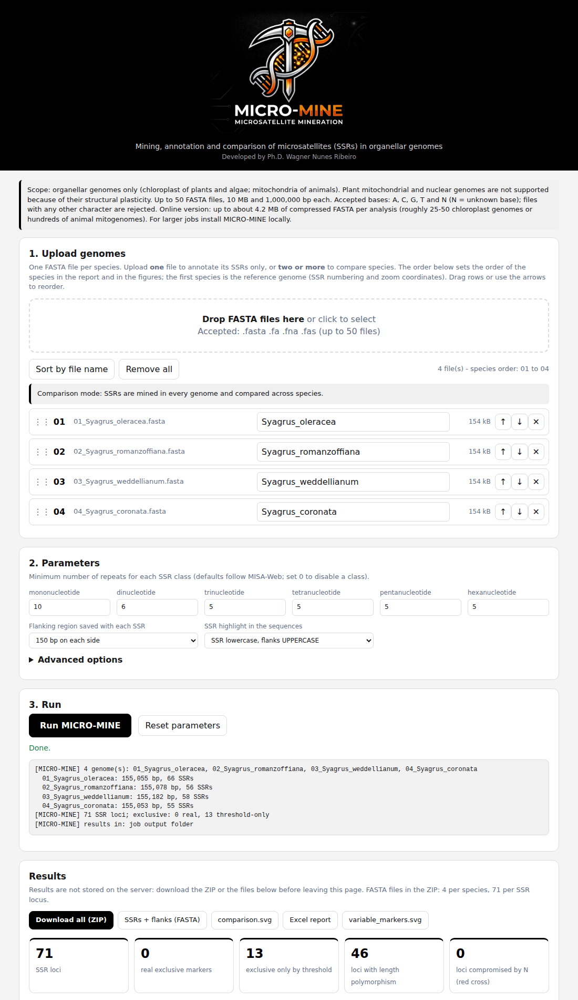

# MICRO-MINE

Mining, annotation and comparison of microsatellites (SSRs) in **organellar genomes** (chloroplast of
plants/algae, mitochondria of animals). Give it **one FASTA** to annotate its SSRs or **2-50 FASTA files** to compare
them across species: shared, absent, longer/shorter and exclusive SSRs, with flanking regions ready for primer design.

## Quick start
    pip install -e ".[web]"
    micromine -i fasta_folder -o results       # command line (files named 01_speciesA.fasta, 02_speciesB.fasta...)
    micromine -i genome.fasta -o results       # single genome: SSR annotation
    micromine-web --port 8000                  # web page on (https://micro-mine.onrender.com/)
    python scripts/dev_vercel.py               # serverless version (as deployed on Render)

Tests: `python tests/test_demo.py && python tests/test_web.py && python tests/test_serverless.py`

## Deployments
* **GitHub + Vercel (free, online lite)**: see [docs/DEPLOY_VERCEL.md](docs/DEPLOY_VERCEL.md)
  (Portuguese: [docs/GUIA_GITHUB_VERCEL_PT.md](docs/GUIA_GITHUB_VERCEL_PT.md)).
  Stateless: about 4 MB of compressed FASTA and 60 s per analysis; nothing is stored on the server.
* **Docker / own server (full)**: `docker build -t micromine . && docker run -p 8000:8000 micromine`.
  Background jobs, 10 MB per file, PDF figures, results kept for 24 h.

## Citation
See [CITATION.cff](CITATION.cff). License: MIT (see `LICENSE`).

## Author
Developed by Ph.D. Wagner Nunes Ribeiro - wagner2@egresso.ufg.br

## Usage
    pip install -e .            # optional PDF output: pip install -e .[pdf]
    micromine -i fasta_folder -o results
    # or: python -m micromine -i fasta_folder -o results
    micromine -i fasta_folder -o results --region 20000-40000   # + zoomed plot

Input files: `01_speciesA.fasta`, `02_speciesB.fasta`, ... The number sets the order of the
species in the report and in the plots; the first file is the reference genome.

## Accepted bases and SSRs compromised by N
Only **A, C, G, T and N** (any case) are accepted. Files containing any other character (IUPAC codes
such as R/Y, U, gaps, digits, protein sequence...) are rejected: the web page scans each file when it is
added, flags the offending files in red with the characters found and blocks the run until they are
fixed or removed (the server checks again; the command line applies the same rule and lists every
offending file). N bases are allowed but never part of an SSR, so an N next to a repeat can truncate
it or hide it. Every SSR with N in its saved flanking region is therefore marked as **compromised**:
a red cross in the figures (with legend), `WARNING_N=<count>` in the FASTA headers,
`compromised_by_N` in the GFF3, the columns *Compromised by N in* / *N bases in flanks* in the Excel
report and a note in the *Notes* column. The *Summary* sheet also gives the number of N bases per
genome and of SSRs compromised by N.

## Single-genome annotation mode
With a single FASTA (`micromine -i genome.fasta -o out`, or one file uploaded to the web page) there is
nothing to compare, so MICRO-MINE annotates the SSRs of that genome only and writes:
`micromine_report.xlsx` (SSR_annotation, Summary with SSRs per class and per kb, Motif_counts, Parameters),
`micromine_SSRs.gff3` (feature type `microsatellite`, loadable in genome browsers), `SSRs_with_flanks.fasta`
(SSR highlighted by case, flanks of the length you chose) and `micromine_annotation_map.svg/.pdf`
(map of the SSRs along each contig, colored by class, plus counts per class). Every SSR is listed,
including copies in inverted repeats. Comparison-only options (similarity, anchor, relax, regions) are ignored.

## Main options
| Option | Default (MISA-Web) |
|---|---|
| `--mono` / `--di` / `--tri` / `--tetra` / `--penta` / `--hexa` | 10 / 6 / 5 / 5 / 5 / 5 (0 disables a class) |
| `--flank` | 150 bp on each side (the web page offers 75 or 150 bp) |
| `--anchor` | 60 bp of flank used to define the "region" |
| `--similarity` | 0.6 (minimum flank similarity) |
| `--relax` | 0.6 (below-threshold search; 0 disables) |
| `--region START-END` | zoomed plot in reference-genome coordinates (repeatable) |
| `--fasta-layout` | `species,locus,consolidated` (comma list or `none`) |
| `--ssr-case` | `lower` = SSR lowercase / flanks UPPERCASE; `upper` = SSR UPPERCASE / flanks lowercase |
| `--threads`, `--pdf`, `--max-files` | 1, off, 50 |

## What counts as "the same SSR"
Same canonical motif (AT = TA, A = T, ...) **and** same region, defined by similar flanking
sequences (k-mers; tolerant to SNPs, reverse strand and rotation of circular genomes).
A SNP that breaks the SSR in one species makes it absent there (or exclusive to the species
that keeps it). A different number of repeats keeps the same locus and is flagged as length
polymorphism.

## Real vs. threshold-only exclusives
For each locus absent in a species the program looks for the same locus with relaxed
thresholds. If found, the SSR is "below threshold" there (e.g. poly-A 9 vs. 10). Only SSRs
with no homologous locus elsewhere get the **gold star** (real exclusive marker); a
**black X** marks exclusivity caused only by the threshold. The *Notes* column flags
homopolymers (validate) and multiple copies in one species (possible IR).

## Variation relative to the other species
`SSR_comparison` has two extra columns: **Variation type** (*Conserved*, *Length polymorphism*,
*Below threshold in some species*, *Absent in some species*) and **Differences vs. other
species**, which lists each species that is *longer*, *shorter* or has *no SSR at the locus*
relative to the median of the other species (e.g. `01: longer (10 vs 9)`). The sheet
`Variation_per_species` gives the same call for every locus x species; `Variation_by_type` and
`Variation_by_species` summarize the counts.

## SSR numbering and coordinates
SSRs are numbered `SSR.01, SSR.02, ...` from top to bottom along the reference (first)
genome; the numbers and exact positions are in the report (`SSR_comparison`, with the
reference-axis position and per-species coordinates in `SSR_per_species`). The figures carry no
numbers, to keep them clean; hovering over an SSR mark in the SVG shows its ID, motif and
position. Each species is a horizontal axis (file order, top to bottom), so the figure grows vertically and stays
readable with ~50 genomes. The first (reference) axis carries light-grey coordinate ticks above the line, every 10 kb (adaptive step for genomes < 40 kb and
for zoomed plots) so readers can locate each SSR. Loci absent in the reference are placed by
interpolation between shared neighbouring loci.

## Outputs
- `micromine_report.xlsx`: SSR_comparison, Presence_Absence, SSR_per_species, Summary, Variation_per_species, Variation_by_type, Variation_by_species, Parameters
- FASTA outputs (choose with `--fasta-layout`; the SSR is highlighted by case, see `--ssr-case`;
  every header has `ssr_in_seq=START-END`, the SSR position inside the extracted sequence, for primer design):
  - `fasta_per_species/NN_species_SSRs.fasta`: all SSRs of one species/input file, as found in its genome
  - `fasta_per_locus/SSR.NN_class_motif.fasta`: one file per SSR locus with the copy from each species,
    reverse-complemented to the orientation of the first copy so the records can be aligned directly
    (only copies that meet the threshold are included)
  - `SSRs_with_flanks.fasta`: one record per locus (first species in which it occurs)
- `micromine_comparison.svg` (all loci), `micromine_variable_markers.svg` (only absences,
  exclusives and polymorphisms) and `micromine_region_START-END.svg` (zoom); `.pdf` with `--pdf`

## Web version (server with background jobs)
    pip install -e ".[web,pdf]"
    micromine-web --port 8000                    # development server
    gunicorn -w 1 --threads 8 -b 0.0.0.0:8000 micromine.web.app:app    # production
    # or: docker build -t micromine . && docker run -p 8000:8000 -v micromine_data:/data micromine

Open the page, drop 1 to 50 FASTA files (1 = SSR annotation only), reorder them (the order becomes the `NN_` prefixes),
edit the species labels, set the thresholds and run. Results (ZIP, Excel, SVG/PDF figures, FASTAs)
are shown in the page and kept for 24 h. The server accepts organellar genomes only
(default: 10 MB and 1,000,000 bp per file). Each analysis runs in its own subprocess, with a
15-minute limit, at most 2 at a time and 20 analyses per IP per hour. Contig names are sanitized
(prevents spreadsheet-formula injection) and job IDs are random 128-bit tokens. Limits can be
changed with `MICROMINE_MAX_FILE_MB`, `MICROMINE_MAX_GENOME_BP`, `MICROMINE_MAX_CONCURRENT`,
`MICROMINE_JOB_TTL_HOURS`, `MICROMINE_JOBS_PER_HOUR` and `MICROMINE_WORKDIR`. For a public
deployment put it behind HTTPS (e.g. nginx) with a request-size limit of ~520 MB and keep
`gunicorn -w 1` (concurrency control is per process).

## Known limitations of the prototype
- Perfect SSRs only (no compound/interrupted SSRs); SSRs spanning the origin of a circular genome are not detected.
- Flanks with large indels or very divergent species may fail to cluster: tune `--similarity` / `--anchor`.
- Plots flip axes of reverse-strand genomes but do not normalize rotations of circular genomes.
- In zoom plots only the first copy of multi-copy loci (e.g. in inverted repeats) is drawn.
- The web page keeps results in a local folder (no database/accounts); the Docker image was not built in the development environment.
